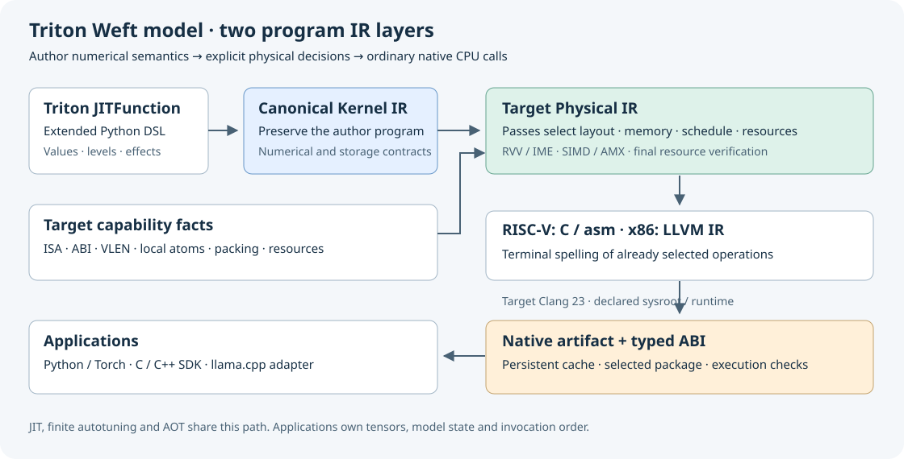

# Triton–Weft

[中文](README.zh-CN.md) · [Handbook](https://tianchen-ai.github.io/triton-weft/) ·
[Examples](docs/weft/getting-started/examples.md) ·
[Weft Bench](https://github.com/Tianchen-ai/triton-weft-bench)

This source tree extends Triton 3.8.0 with `@triton.jit(model="weft")` for
structured, finite-width CPU programs. The shared Python frontend produces
Canonical Weft IR; RISC-V passes emit intrinsic C/local assembly for RVV and IME,
while x86 passes emit LLVM IR for SIMD and AMX. JIT, autotuning, caching,
native artifacts and the Python package remain part of Triton.

Write familiar Triton tensor code for RISC-V and x86 CPUs, then use optional Encoding,
Level and finite-width operations when packed storage and data reuse need to be
part of the program. The compiler selects RVV operations and supported IME
matrix fragments while preserving those numerical and storage contracts.
Applications can launch CPU tensors directly or deploy compiled libraries into
an existing C/C++ thread pool, including llama.cpp.

The standard Triton GPU compilation routes are retained. This is a traceable
upstream fork: `main` is the product branch and `v3.8.0` is its upstream base.
See the [upstream modification map](docs/weft/development/upstream.md).



## Build and install

Build this checkout in a dedicated Python environment. A normal upstream
`pip install triton` does not include the Weft extension.

Release wheels use the `triton` distribution name and an explicit `+weft`
version. The project's [wheel index](https://tianchen-ai.github.io/triton-weft/wheels/)
and [Releases](https://github.com/Tianchen-ai/triton-weft/releases) describe the
supported Python ABI and libc requirements. Source builds remain available below.

```sh
python -m venv /path/to/environment
/path/to/environment/bin/python -m pip install -r python/requirements.txt
CC=/path/to/matched-llvm-sdk/bin/clang \
CXX=/path/to/matched-llvm-sdk/bin/clang++ \
LLVM_SYSPATH=/path/to/matched-llvm-sdk \
TRITON_WEFT_CLANG_ROOT=/path/to/native-clang-23 \
TRITON_WEFT_OPENMP_LIBRARY=/path/to/libomp.so \
TRITON_WEFT_OPENMP_INCLUDE_DIR=/path/to/openmp-headers \
TRITON_BUILD_DIR=/path/to/build \
TRITON_BUILD_PROTON=OFF \
/path/to/environment/bin/python -m pip install --no-build-isolation .
```

Use the LLVM revision in [cmake/llvm-info.json](cmake/llvm-info.json).
The [installation guide](docs/weft/getting-started/installation.md)
covers bundled Clang/OpenMP, RISC-V native wheels, cross compilation and the
PyTorch source integration. Install one Triton distribution per environment.

## Write, compile and run

```python
import numpy as np
import triton
import triton.language as tl

@triton.jit(model="weft")
def affine(X, Y, N, scale, B: tl.constexpr):
    offsets = tl.program_id(0) * B + tl.arange(0, B)
    active = offsets < N
    x = tl.load(X + offsets, mask=active, other=0.0)
    tl.store(Y + offsets, x * scale, mask=active)

x = np.arange(131, dtype=np.float32)
y = np.empty_like(x)
affine[(triton.cdiv(x.size, 64),)](x, y, x.size, 1.25, B=64, num_cpu_threads=2)
print(y[:8])
```

Save the kernel in a Python file and run it on a supported RISC-V or x86 host.
Grid size and OpenMP thread count are independent. Masked-off lanes do not
access memory. Standard `tl.dot(a, b, acc)`, reductions, inclusive scans and
pointer atomics use Triton's language entry points; explicit View/Encoding/Level
constructs add the Weft programming model.

See the [runnable quickstart](docs/weft/getting-started/quickstart.md)
for a complete kernel. `CompiledKernel.asm` exposes `weftir`, target physical IR,
generated C or LLVM IR, and `so`. Exported native artifacts support Python and
C/C++; the [llama.cpp integration](docs/weft/integrations/llama-cpp.md) validates
explicit GGML role bindings. CPU tensors use the same JIT launch.

The [example guide](docs/weft/getting-started/examples.md) covers
pointwise code, row softmax, matmul, scan, histogram, autotuning, native export,
PyTorch and the existing quantized/model programs. For example:

```sh
python -m examples.weft.language.triton_basics --operation softmax
python -m examples.weft.language.triton_basics --operation histogram
python -m examples.weft.deployment.autotune_export /path/to/new/artifact
```

Choose a route on each contraction with `tl.dot(a, b, engine="vector")` or
`engine="matrix"`. The default prefers a legal matrix implementation, then
vector. It never narrows F32 to BF16 implicitly. Compilation targets and execution
cores are separate: `triton.cpu.target("k3-a100")` constructs a target, while
`python -m triton.tools.cpu --profile k3-a100 --cpus 8-15 application.py` registers
and binds the process before JIT. See [hardware selection](docs/weft/getting-started/hardware.md).

## Documentation

- [Weft language and compiler handbook](docs/weft/index.md)
- [Encoding, View and storage](docs/weft/dsl/encoding-and-artifacts.md)
- [Level and value lifetimes](docs/weft/dsl/values-and-levels.md)
- [JIT, autotune and runtime](docs/weft/compiler/runtime.md)
- [PyTorch and application integration](docs/weft/integrations/overview.md)
- [Native SDK and llama.cpp](docs/weft/compiler/native-sdk.md)
- [Target extension contracts](docs/weft/development/extensions.md)
- [Contributing](CONTRIBUTING.md)

Correctness and performance measurements use the independent Weft Bench;
this repository contains the compiler, runtime and application examples.

PyTorch graph integration uses the supported Triton HOP/Inductor interfaces
described in the installation guide. Install its source seam once with
`python -m triton.tools.pytorch`; kernels still use ordinary Triton launches and
`torch.compile(..., options={"cpu_backend": "triton"})`.

## Measured application performance


These are measured **normal llama.cpp → native replacement package** comparisons,
with prefill and decode timed separately. They are not extrapolated from operator
microbenchmarks. The retained campaign includes **1.531×** K1 Llama2 prefill and
**1.690×** x86 Llama2 prefill. Some phases remain near parity. K3's CPU/RVV and
vendor IME2 references are separate policies: the approximately 1.95× CPU/RVV
result must not be presented as a gain over the vendor matrix backend.

Workloads cover Llama2 7B Q4_0, DeepSeek-R1-Distill-Llama 8B Q4_K_M and x86
Qwen2.5 14B Q4_K_M. Native libraries are compiled and loaded before timing;
replacement counts and separate numerical checks accompany the observations.
[Model protocols](https://github.com/Tianchen-ai/triton-weft-bench/blob/main/src/weft_bench/catalogs/models.json)
record phase lengths, threads, repetitions and normal backend per case.
[Retained results](https://github.com/Tianchen-ai/triton-weft-bench/releases/download/v0.4.0/model-results.json)
provide the plotted values. These pre-restructure artifact measurements were
preserved during reorganization; they are not new release-wide performance claims.

Results describe these exported artifacts, models and workloads, not every
RISC-V machine or model. The independent [Bench project](https://github.com/Tianchen-ai/triton-weft-bench)
owns workload definitions, normal GGML/llama.cpp baselines and reproduction.
Native operator, grid launch, Python call and model timings remain separate.

## Upstream and licensing

[Triton](https://github.com/triton-lang/triton/tree/v3.8.0) supplies the shared
frontend, JIT, compiler infrastructure and GPU backends. Its
[official documentation](https://triton-lang.org/) describes the standard model.
The original research is [Triton: An Intermediate Language and Compiler for
Tiled Neural Network Computations](https://doi.org/10.1145/3315508.3329973).

Triton retains its MIT license; the Weft compiler and migrated modules retain
Apache-2.0. [NOTICE](NOTICE) identifies component ownership and third-party
licenses. The extension is maintained in this repository; upstream ownership
and release procedures do not apply automatically.
