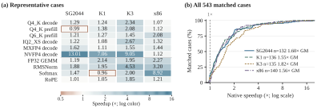
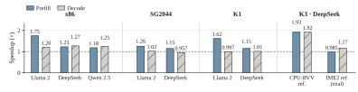

# Triton–Weft

**Write CPU kernels in Triton. Control encoded data, computation groups and reuse with Weft.**

[中文](README.zh-CN.md) · [English handbook](https://tianchen-ai.github.io/triton-weft/) · [中文工具书](https://tianchen-ai.github.io/triton-weft/zh/) · [Examples](examples/weft/README.md) · [Experiment reproduction](docs/weft/experiments/reproduce.md)

Triton–Weft extends Triton's Python language and compiler for **RISC-V and x86 CPUs**.
Start with `tl.load`, `tl.store`, reductions and `tl.dot`. Add **Encoding** to describe
packed storage, **Level** to organize logical computation, and **state/stage** to
control accumulation and reuse. These relationships stay explicit as the compiler
chooses vector or matrix instructions, physical layouts, local storage and schedules.

The result is one Triton workflow: `@triton.jit(model="weft")`, `kernel[grid](...)`,
`triton.Config`, autotuning, cached compilation and native export.

[](docs/weft/assets/paper/compiler.svg)

*The compiler keeps source scopes, axes, state and Encoding in Canonical IR.
RISC-V emits intrinsic C and local assembly; x86 emits LLVM IR.*

## Install

Install this project's Triton distribution in a dedicated environment:

```sh
python3 -m venv .venv
. .venv/bin/activate
python -m pip install --index-url https://tianchen-ai.github.io/triton-weft/wheels/ 'triton==3.8.0+weft.2'
python -m pip install numpy
```

The [release](https://github.com/Tianchen-ai/triton-weft/releases/tag/v3.8.0-weft.2)
provides Linux x86-64 CPython 3.10 and RISC-V CPython 3.11/3.12/3.14 wheels,
including Clang 23 and OpenMP. The [installation guide](docs/weft/getting-started/installation.md)
lists system requirements and the source build for other Python environments or current `main`.
The distribution and import name are both `triton`.

## Run your first kernel

Save this as `affine.py` and run `python affine.py`:

```python
import numpy as np
import triton
import triton.language as tl

@triton.jit(model="weft")
def affine(X, Y, N, scale, bias, B: tl.constexpr):
    i = tl.program_id(0) * B + tl.arange(0, B)
    x = tl.load(X + i, mask=i < N, other=0.0)
    tl.store(Y + i, x * scale + bias, mask=i < N)

x = np.arange(131, dtype=np.float32)
y = np.empty_like(x)
compiled = affine[(triton.cdiv(x.size, 64),)](
    x, y, x.size, 1.25, -0.5, B=64, num_cpu_threads=2
)
print(y[:4])  # [-0.5, 0.75, 2.0, 3.25]
```

Here the grid contains three independent programs; two CPU threads execute them.
The final program uses a mask for its three valid elements. The first call compiles
for the selected execution cores; subsequent calls reuse Triton's cache.

## Express the structure that matters

| Author choice | Triton–Weft expression | What the compiler learns |
|---|---|---|
| Packed bytes and logical fields | `@triton.encoding`, `tl.View` | Field coordinates, bit widths, storage and alignment |
| Logical groups and tails | `with tl.level.rows(...)`, `blocks(...)` | Which outputs share a computation and its coverage |
| Accumulation and reuse | `tl.state(...)`, `tl.stage(...)` | Initialization frequency, carried state and shared values |
| Numerical grouping | `tl.mac_groups`, `tl.widen`, `tl.reduce` | Partial-sum widths and conversion boundaries |
| Vector or matrix arithmetic | `tl.dot(..., engine="vector" or "matrix")` | A constraint on that contraction's physical implementation |

Authors can independently change a format, a numerical group or a reuse scope.
The compiler implements those choices through shared analysis and target passes.
The [programming-model chapter](docs/weft/programming-model/index.md) walks through
these relationships with the paper's quantized projection example.

| Target | Vector route | Matrix route |
|---|---|---|
| SG2044 | RVV, VLEN 128 | — |
| K1 | RVV, VLEN 256 | IME1 |
| K3 X100 / A100 | RVV, VLEN 256 / 1024 | IME2 on A100 |
| x86 | AVX2 / AVX-512, VNNI | Intel AMX INT8/BF16 |

`triton.cpu.target()` constructs compilation targets; `triton.tools.cpu` selects
execution cores before JIT. [Choose a target and engine](docs/weft/getting-started/hardware.md).

## Learn by running

After cloning this repository, run from its root with the installed wheel:

```sh
python -m examples.weft.language.triton_basics --operation softmax
python -m examples.weft.language.encoding
python -m examples.weft.language.levels
python -m examples.weft.language.contraction --engine vector
python -m examples.weft.deployment.autotune_export /tmp/affine-artifact
```

The [bilingual example guide](examples/weft/README.md) explains inputs, expected
outputs and the source construct to change. Continue with
[PyTorch](docs/weft/integrations/overview.md),
[native C++ deployment](docs/weft/compiler/native-sdk.md), or
[llama.cpp](docs/weft/integrations/llama-cpp.md).

For llama.cpp, Triton compiles a kernel and exports a native library plus its typed
ABI. The adapter binds it to a matching GGML call site; GGML workers call that
function during inference. The [deployment tutorial](docs/weft/integrations/llama-cpp.md)
covers source, export, adapter build, loading and replacement counters.

## Experiments and reproduction

**The paper's kernel and model experiments can be reproduced with Triton–Weft
and [Triton–Weft Bench](https://github.com/Tianchen-ai/triton-weft-bench).**
Bench provides the author programs, workload shapes, reference-library recipes,
model protocols, numerical checks and timing commands.

[](docs/weft/assets/paper/operators.svg)

*Paper dataset: 553 operator–platform cases, including 543 matched native comparisons.
Geometric mean speedups are 1.60× on SG2044, 1.55× on K1, 1.82× on K3 A100 and
1.56× on Xeon Platinum 8470Q. The distribution includes every matched case.*

[](docs/weft/assets/paper/models.svg)

*Nine model configurations cover Llama 2 7B, DeepSeek 8B and Qwen 2.5 14B.
Each pair shows prefill and decode against its matching normal llama.cpp backend.
K3 CPU–RVV and vendor IME2 are separate reference policies.*

Start by inspecting a case, then run it with your configured target:

```sh
git clone https://github.com/Tianchen-ai/triton-weft-bench.git
cd triton-weft-bench
python -m pip install '.[verification]'
mkdir -p .local
cp configs/example.json .local/bench.local.json
export WEFT_BENCH_CONFIG="$PWD/.local/bench.local.json"
# Configure the target, connection and references using the target setup guide.
weft-bench list --kind suites --target k1
weft-bench show q4_k_dot --target k1
weft-bench op q4_k_dot --target k1 --output output/current/k1/q4_k_dot
```

The [reproduction chapter](docs/weft/experiments/reproduce.md) covers full suites,
target-side JIT, fixed references, model packages and output files. The
[results and figure sources](docs/weft/experiments/results.md) identify the paper's
measured snapshots and timing boundaries.

## Project map

| Area | Location |
|---|---|
| Language and common Triton frontend | `python/triton/language`, `python/triton/compiler` |
| JIT, CPU backend and native loading | `python/triton/runtime`, `python/triton/backends/weft` |
| Canonical IR and shared analysis | `third_party/weft/lib/Dialect/Kernel`, `third_party/weft/lib/Analysis` |
| RISC-V / x86 physical compilation | `third_party/weft/lib/Target/RISCV`, `third_party/weft/lib/Target/X86` |
| Native runtime and application adapters | `third_party/weft/lib/Runtime`, `integrations` |
| Runnable tutorials / bilingual handbook | `examples/weft`, `docs/weft` |
| Detailed design contracts | `docs/specification` |

This is a fork of [Triton v3.8.0](https://github.com/triton-lang/triton/tree/v3.8.0);
`main` is the product branch. The [upstream map](docs/weft/development/upstream.md)
explains each extension seam. See [Contributing](CONTRIBUTING.md) to develop a pass
or a hardware extension.

Upstream Triton retains MIT licensing. Weft additions retain Apache-2.0;
[NOTICE](NOTICE) records component attribution.
