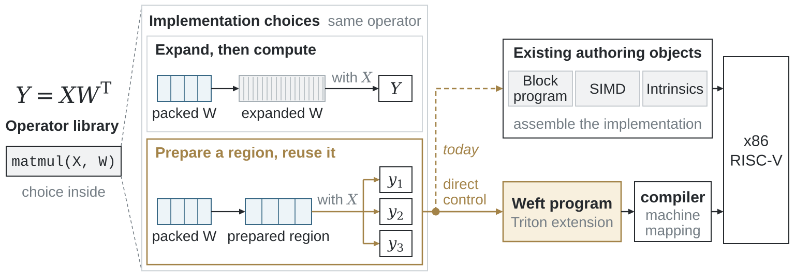
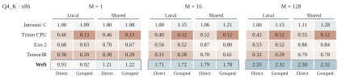
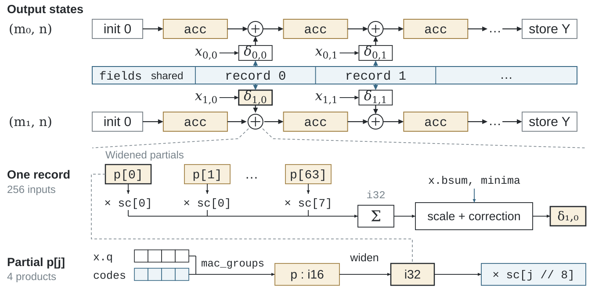
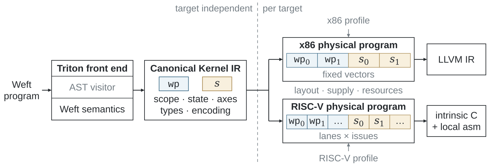

# Triton–Weft 1.0

[中文](README.zh-CN.md) · [Download 1.0](https://github.com/Tianchen-ai/triton-weft/releases/tag/v1.0.0) · [Handbook](https://tianchen-ai.github.io/triton-weft/) · [Examples](examples/weft/README.md) · [Bench website](https://tianchen-ai.github.io/triton-weft-bench/) · [All paper results](https://tianchen-ai.github.io/triton-weft-bench/paper/gallery/)

**Compose expert CPU kernels. Let the compiler construct their machine execution.**

The interface `Y = X @ W.T` leaves the most consequential implementation choices
open. Should packed weights be expanded first, or should one prepared region
serve several outputs? Which products share a narrow partial sum, and how long
should the output accumulator live? High-performance CPU kernels depend on these
choices. Expressing them through blocks, explicit vectors or intrinsics also
leaves the developer to maintain their connections as the kernel changes.

Weft makes those connections programmable. Encoded views describe stored fields;
typed groups specify local arithmetic; computation levels give shared inputs and
initialized state their own scopes. Authors can compose and evolve these choices
while the compiler constructs operand layouts, register partitions and vector or
matrix instructions for **x86 and RISC-V**.

[](docs/weft/assets/paper/overview.svg)

*One operator admits different implementations. Weft expresses the selected
organization in source; its compiler maps that organization to the CPU.*

Triton–Weft implements this model by extending Triton. Programs use
`@triton.jit(model="weft")` and the familiar `kernel[grid](...)` interface, with
configuration, autotuning, caching and native export. The installed
`triton.kernels.weft` library includes dense and quantized projections,
normalization, online attention, streaming statistics and stateful model
components, together with reusable formats and numerical helpers.

Across **543 matched operator comparisons**, per-target geometric-mean speedups
over optimized library references are **1.32–1.83×**. The
[results below](#performance-control-and-reuse) connect these gains to author
control, source reuse and complete llama.cpp inference. **[Triton–Weft Bench](https://github.com/Tianchen-ai/triton-weft-bench)**
provides the workloads, references, reproduction commands and
[complete paper figure gallery](https://tianchen-ai.github.io/triton-weft-bench/paper/gallery/).

Weft's release is **1.0.0**, based on upstream Triton **3.8.0**. The distribution
is **`triton==3.8.0+weft.1.0.0`**. `triton.__weft_version__` identifies Weft;
`triton.__version__` preserves the upstream base identity.

## Performance, control and reuse

The paper evaluates **553 operator/target cases**, including **543 matched
comparisons** with optimized GGML and oneDNN references. The distributions below
include every matched comparison.

[](docs/weft/assets/paper/operators-ecdf.svg)

| CPU | SG2044 | K1 | K3 A100 | Xeon Platinum 8470Q |
|---|---:|---:|---:|---:|
| Geometric-mean speedup | **1.60×** | **1.54×** | **1.83×** | **1.32×** |
| Matched comparisons | 132 | 136 | 135 | 140 |

The same kernels accelerate complete llama.cpp prefill and decode. The figure
covers eight model/platform deployments; K3 also shows a second reference backend.
SG2044 uses 64 application threads and the other CPUs use eight.

[](docs/weft/assets/paper/models.svg)

**Control becomes execution.** In the Q4_K study, five routes implement local or
shared preparation crossed with direct or grouped accumulation. Calls include
activation quantization and the complete projection at `N=256, K=4096`; each
shape is normalized to intrinsic C local/direct. The
[Q6_K comparison and selected bindings](https://tianchen-ai.github.io/triton-weft-bench/paper/gallery/#five-routes-for-the-same-control-tasks)
extend the same task.

[](docs/weft/assets/paper/routes-q4.svg)

**New formats reuse existing knowledge.** Adding MXFP4, NVFP4 and IQ2_XXS
dequantization establishes definitions that the subsequent dot operator reuses.
The figure separates added Encoding, decoder and operator source from reused
definitions. The [model and compiler results](https://tianchen-ai.github.io/triton-weft/experiments/results/)
also show how source relationships enable decoding, forwarding and state retention.

[](docs/weft/assets/paper/increment-measurements.svg)

**Explore and reproduce:** [all paper result figures](https://tianchen-ai.github.io/triton-weft-bench/paper/gallery/)
· [sixteen CSV tables](results/README.md) · [Bench commands](docs/weft/experiments/reproduce.md)
· [measurement provenance](results/provenance.json).


## Build and install

Download a matching Linux wheel from [Weft 1.0](https://github.com/Tianchen-ai/triton-weft/releases/tag/v1.0.0), then run `python -m pip install ./triton-*.whl numpy`.
The release also provides complete source packages, the bilingual offline handbook and checksums.

The source tree builds without a `.git` directory. Use Python 3.10 or newer,
Git, CMake, Ninja, GCC 12 or newer and the LLVM/MLIR revision in
[`cmake/llvm-info.json`](cmake/llvm-info.json). The pinned revision supplies
Clang 23; its OpenMP runtime must use the same dispatch ABI.

To build the dependency SDK from the public LLVM project:

```sh
python3 -m venv .venv
. .venv/bin/activate
python -m pip install -r python/requirements.txt numpy pytest
LLVM_PROJECT_PATH="$PWD/.deps/llvm-project" \
LLVM_BUILD_PATH="$PWD/.deps/llvm-build" \
LLVM_INSTALL_PATH="$PWD/.deps/llvm" \
bash scripts/build-llvm-project.sh
```

An existing SDK built from that exact revision can be selected instead. The
installer discovers the SDK's Clang and OpenMP paths and uses host GCC to build
the extension:

```sh
LLVM_SYSPATH="$PWD/.deps/llvm" bash scripts/build-weft.sh
python -c 'import triton; print("Weft", triton.__weft_version__, "on Triton", triton.__version__)'
```

LLVM installations with a target-specific library directory should pass that
directory's `libomp.so`. The build checks the OpenMP entry points, headers and
native Clang target. GCC compiles the product; the bundled Clang 23 compiles
generated CPU kernels. The [installation guide](docs/weft/getting-started/installation.md)
also describes explicit and cross-compilation toolchains.

## Write and call a kernel

Save this complete program as `quickstart.py` and run it after installation:

```python
from __future__ import annotations
import numpy as np
import triton
import triton.language as tl

@triton.jit(model="weft")
def row_sum_squares(X: tl.View[tl.f32, (M, N)], Y: tl.View[tl.f32, (M,)],
                    BLOCK: tl.constexpr = 32):
    with tl.level.rows(M, group=1) as row:
        values = tl.stage(tl.load(X[row]))
        total = tl.state(tl.f32, [1], init=0)
        with tl.level.blocks(N, extent=BLOCK) as block:
            part = values[:, block]
            total += tl.reduce(part * part, axis="n")
        tl.store(Y[row], total)

x = np.random.default_rng(19).normal(size=(4, 65)).astype(np.float32)
y = np.empty(4, dtype=np.float32)
compiled = row_sum_squares[(1,)](x, y, BLOCK=32, num_cpu_threads=1)
np.testing.assert_allclose(y, np.sum(x.astype(np.float64)**2, axis=1), rtol=1e-5)
print(y, list(compiled.asm))
```

The grid describes independent programs; `num_cpu_threads` selects the CPU
worker count. Typed `tl.View` arguments additionally expose logical fields,
shapes and storage to the compiler.

The row owns one staged input observation and one accumulator. Its inner blocks
update that same state, including the tail. The
[runnable version](examples/weft/quickstart.py) also writes the actual IR and exports
a native artifact:

```sh
python -m examples.weft.quickstart --dump-ir /tmp/weft-ir --export /tmp/weft-native
```

| Author object | Program expression | Information used by compilation |
|---|---|---|
| Stored fields | `@triton.encoding`, `tl.View` | Coordinates, bits, storage and alignment |
| Logical regions | `tl.level` | Independent outputs, grouping and active tails |
| Shared values and state | `tl.stage`, `tl.state` | Input observations, initialization and updates |
| Numerical groups | `tl.mac_groups`, `tl.widen`, `tl.reduce` | Local widths and conversion positions |
| Execution class | `tl.dot(..., engine=...)` | Vector or legal matrix construction |

Ordinary Python factories can bind Encodings and JIT helpers once. In the
library's [`organized_projection.py`](python/triton/kernels/weft/ggml/blocks/mul_mat/organized_projection.py),
Q4_K and Q6_K share the typed entry, preparation framework, weighted computation
and both output-state traversals. Each format supplies its field helper; Q4_K
also supplies its correction fields.

[](docs/weft/assets/paper/model.svg)

[Online attention](python/triton/kernels/weft/attention/online_f32.py) and
[Welford](python/triton/kernels/weft/programs/statistics.py) compose different
coupled states through the same programming model.

## Run complete examples

Run these from the source root after installation:

```sh
python -m examples.weft.kernels.projection
python -m examples.weft.kernels.welford
python -m examples.weft.kernels.attention
python -m examples.weft.kernels.gemm
python -m pytest python/test/weft -s --tb=short
```

Every example prepares its own inputs, invokes the installed product and checks
the complete output against an independent reference. The product tests also
cover factory specialization, native export/reload, logical tails and the x86
integer/BF16 matrix paths. Matrix tests require the corresponding CPU facilities.

Host programs under `triton.kernels.weft.programs` retain the normal `Program`,
`Operators`, workspace, KV-cache, MoE and state-space interfaces. Import only the
task or host integration needed by the application. The
[handbook](docs/weft/index.md) and [example guide](examples/weft/README.md)
explain the language and deployment interfaces.

## Native deployment

Call `compiled.export(directory)` to save the native library, typed ABI and
runtime dependencies. `triton.runtime.weft.artifact.load(directory)` reloads it.
The SDK installs `<weft/runtime.h>` and `<weft/runtime.hpp>`; their source lives
in `third_party/weft/runtime/include/weft`. The native ABI and include names are
the same on both CPU families. See the
[C++ deployment example](examples/weft/deployment) and
[native SDK guide](docs/weft/compiler/native-sdk.md).


## Source map

[](docs/weft/assets/paper/compiler.svg)

| Component | Location |
|---|---|
| Language and frontend | `python/triton/language`, `python/triton/compiler` |
| JIT, CPU backend and native calls | `python/triton/runtime`, `python/triton/backends/weft` |
| Normal CPU kernel library | `python/triton/kernels/weft` |
| Canonical IR and common analysis | `third_party/weft/lib/Dialect/Kernel`, `third_party/weft/lib/Analysis` |
| Physical RISC-V IR | `third_party/weft/lib/Dialect/RISCV` |
| Lowering, optimization and emission | `third_party/weft/lib/Target` |
| Native runtime and public SDK | `third_party/weft/lib/Runtime`, `third_party/weft/runtime/include` |
| Examples and product regressions | `examples/weft`, `python/test/weft` |

This complete fork is based on Triton v3.8.0. Upstream Triton retains its MIT
license; Weft additions retain Apache-2.0. Component attribution and third-party
notices are preserved in `LICENSE`, `NOTICE` and `third_party/weft/licenses`.
