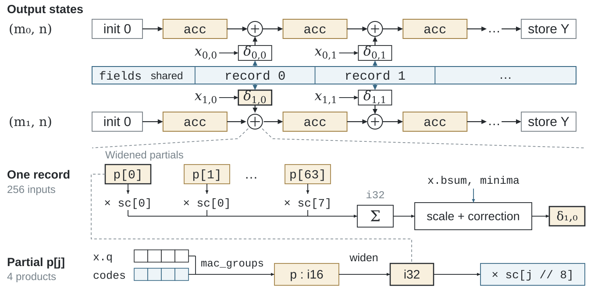
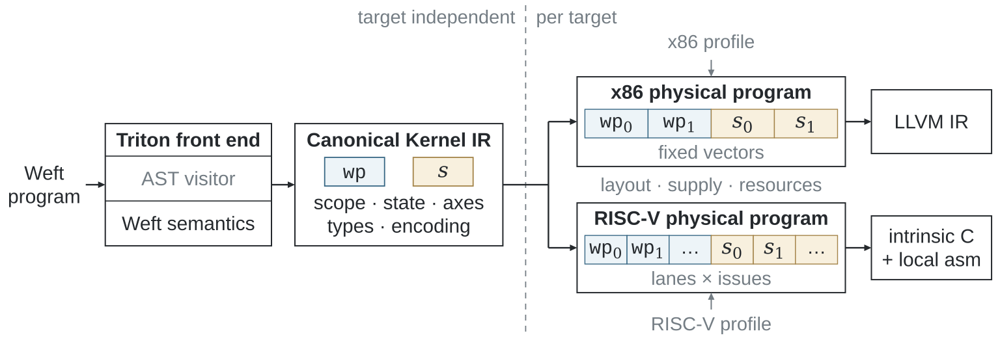

# Triton–Weft 1.0

[English](README.md) · [中文手册](https://tianchen-ai.github.io/triton-weft/zh/) · [示例](examples/weft/README.zh-CN.md) · [Bench](https://github.com/Tianchen-ai/triton-weft-bench) · [发布说明](docs/weft/development/release.zh.md)

**用编码字段、带类型计算、共享值和状态组合高性能 CPU 内核。**

Weft 是通过扩展 Triton 实现的编程模型。源程序显式表达数据表示、数值分组、
共享和状态更新，编译器利用这些关系为 x86 和 RISC-V 构造向量与矩阵执行。
程序沿用 `@triton.jit(model="weft")`、`kernel[grid](...)`、配置、自动调优、
缓存及原生导出接口。

可安装的 `triton.kernels.weft` 提供内核、存储格式、布局、数值辅助函数、
调优资源和主机端组合，包括稠密与量化投影、归一化、在线注意力、流式统计及
带状态的模型组件。NumPy 和 CPU Torch 是可选的主机缓冲区接入方式。

Weft 的发布版本为 **1.0.0**，基于上游 Triton **3.8.0**。发行包版本为
**`triton==3.8.0+weft.1.0.0`**；`triton.__weft_version__` 表示 Weft 版本，
`triton.__version__` 保持上游基础版本。

## 构建与安装

源码在没有 `.git` 目录时也可构建。需要 Python 3.10 或更新版本、Git、CMake、
Ninja、GCC 12 或更新版本，以及
[`cmake/llvm-info.json`](cmake/llvm-info.json) 固定的 LLVM/MLIR 版本。
该版本提供 Clang 23；OpenMP 运行时须使用匹配的调度 ABI。

从公开 LLVM 项目构建依赖 SDK：

```sh
python3 -m venv .venv
. .venv/bin/activate
python -m pip install -r python/requirements.txt numpy pytest
LLVM_PROJECT_PATH="$PWD/.deps/llvm-project" \
LLVM_BUILD_PATH="$PWD/.deps/llvm-build" \
LLVM_INSTALL_PATH="$PWD/.deps/llvm" \
bash scripts/build-llvm-project.sh
```

也可以选用由同一版本构建的现有 SDK。安装脚本找到 SDK 中的 Clang、OpenMP 路径，
使用宿主 GCC 构建扩展：

```sh
LLVM_SYSPATH="$PWD/.deps/llvm" bash scripts/build-weft.sh
python -c 'import triton; print("Weft", triton.__weft_version__, "on Triton", triton.__version__)'
```

若 LLVM 将库安装到目标专属目录，应传入该目录中的 `libomp.so`。
构建会检查 OpenMP 入口、头文件与 Clang 本机目标。GCC 编译产品，随附的 Clang 23
编译生成的 CPU 内核。
[安装指南](docs/weft/getting-started/installation.zh.md)进一步说明显式工具链与交叉编译。

## 编写和调用内核

将以下完整程序保存为 `quickstart.py`，安装后运行：

```python
from __future__ import annotations
import numpy as np
import triton
import triton.language as tl

@triton.jit(model="weft")
def row_sum_squares(X: tl.View[tl.f32, (M, N)], Y: tl.View[tl.f32, (M,)],
                    BLOCK: tl.constexpr = 32):
    with tl.level.rows(M, group=1) as row:
        values = tl.stage(tl.load(X[row]))
        total = tl.state(tl.f32, [1], init=0)
        with tl.level.blocks(N, extent=BLOCK) as block:
            part = values[:, block]
            total += tl.reduce(part * part, axis="n")
        tl.store(Y[row], total)

x = np.random.default_rng(19).normal(size=(4, 65)).astype(np.float32)
y = np.empty(4, dtype=np.float32)
compiled = row_sum_squares[(1,)](x, y, BLOCK=32, num_cpu_threads=1)
np.testing.assert_allclose(y, np.sum(x.astype(np.float64)**2, axis=1), rtol=1e-5)
print(y, list(compiled.asm))
```

grid 表示独立程序实例，`num_cpu_threads` 指定 CPU 工作线程数。
带类型的 `tl.View` 参数还能向编译器提供逻辑字段、形状与存储信息。

行层持有一次共享输入观察及一个累加状态，内部的逻辑块共同更新这个状态，包括尾部。
[可运行版本](examples/weft/quickstart.py) 还可以写出实际 IR，并导出原生程序：

```sh
python -m examples.weft.quickstart --dump-ir /tmp/weft-ir --export /tmp/weft-native
```

| 作者对象 | 程序表达 | 编译使用的信息 |
|---|---|---|
| 存储字段 | `@triton.encoding`、`tl.View` | 坐标、位宽、存储与对齐 |
| 逻辑区域 | `tl.level` | 独立输出、分组与有效尾部 |
| 共享值与状态 | `tl.stage`、`tl.state` | 输入观察、初始化与更新 |
| 数值分组 | `tl.mac_groups`、`tl.widen`、`tl.reduce` | 局部位宽与转换位置 |
| 执行类别 | `tl.dot(..., engine=...)` | 向量或合法矩阵执行的构造 |

普通 Python 工厂可以一次绑定 Encoding 和 JIT 辅助函数。
库中的 [`organized_projection.py`](python/triton/kernels/weft/ggml/blocks/mul_mat/organized_projection.py)
让 Q4_K 与 Q6_K 共用带类型入口、准备框架、加权计算和两种输出状态遍历。
各格式提供自己的字段辅助函数，Q4_K 另外提供校正字段。

[](docs/weft/assets/paper/model.svg)

[在线注意力](python/triton/kernels/weft/attention/online_f32.py) 和
[Welford](python/triton/kernels/weft/programs/statistics.py) 通过同一模型组合不同的耦合状态。

## 运行完整示例

安装后，在源码根目录运行：

```sh
python -m examples.weft.kernels.projection
python -m examples.weft.kernels.welford
python -m examples.weft.kernels.attention
python -m examples.weft.kernels.gemm
python -m pytest python/test/weft -s --tb=short
```

每个示例独立准备输入、调用安装的产品，并用独立参考检查全部输出。
产品测试还覆盖工厂特化、原生导出和重新加载、逻辑尾部，以及 x86 整数与 BF16
矩阵路径。矩阵测试需要相应 CPU 能力。

`triton.kernels.weft.programs` 中的主机程序提供 `Program`、`Operators`、
工作空间、KV-cache、MoE 和状态空间接口。应用可以只导入所需任务与主机接入。
[工具书](docs/weft/index.zh.md)与[示例指南](examples/weft/README.zh-CN.md)
说明语言及部署接口。

## 原生部署

`compiled.export(directory)` 保存原生库、带类型 ABI 和运行时依赖，
`triton.runtime.weft.artifact.load(directory)` 重新加载。
SDK 安装 `<weft/runtime.h>` 与 `<weft/runtime.hpp>`，源码位于
`third_party/weft/runtime/include/weft`。两类 CPU 使用相同的原生 ABI 和头文件名。
参见 [C++ 部署示例](examples/weft/deployment)与
[原生 SDK 指南](docs/weft/compiler/native-sdk.zh.md)。

## 测量结果

论文最终数据覆盖 **553 个算子／目标案例**、**543 个匹配对照**，以及八个模型／平台部署
的完整推理阶段。SG2044 推理使用 64 线程，K1、K3 和 x86 使用八线程。
K3 的 CPU 向量参考与厂商 IME2 参考配置分别标明。

[](docs/weft/assets/paper/operators-ecdf.svg)

项目附带全部十四份[结果表](results/README.md)、当前图件与来源记录。
[复现指南](docs/weft/experiments/reproduce.zh.md) 将安装后的产品与 Bench 的输入构造、
强参考分派、数值检查及原生／应用计时连接起来。源码包包含完整编译器、正常内核库、
示例与正确性测试。

## 源码结构

[](docs/weft/assets/paper/compiler.svg)

| 模块 | 位置 |
|---|---|
| 语言与前端 | `python/triton/language`、`python/triton/compiler` |
| JIT、CPU 后端与原生调用 | `python/triton/runtime`、`python/triton/backends/weft` |
| 正常 CPU 内核库 | `python/triton/kernels/weft` |
| Canonical IR 与共同分析 | `third_party/weft/lib/Dialect/Kernel`、`third_party/weft/lib/Analysis` |
| RISC-V 物理 IR | `third_party/weft/lib/Dialect/RISCV` |
| 降低、优化与发射 | `third_party/weft/lib/Target` |
| 原生运行时与公开 SDK | `third_party/weft/lib/Runtime`、`third_party/weft/runtime/include` |
| 示例与产品回归 | `examples/weft`、`python/test/weft` |

完整 fork 基于 Triton v3.8.0。上游 Triton 保留 MIT 许可证，Weft 扩展保留
Apache-2.0。`LICENSE`、`NOTICE` 与 `third_party/weft/licenses` 保存组件归属及第三方声明。
