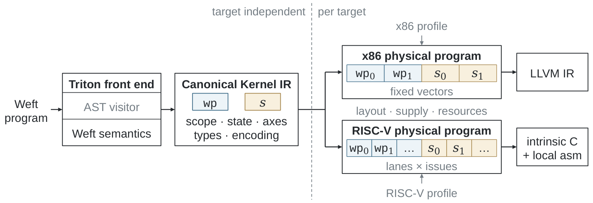
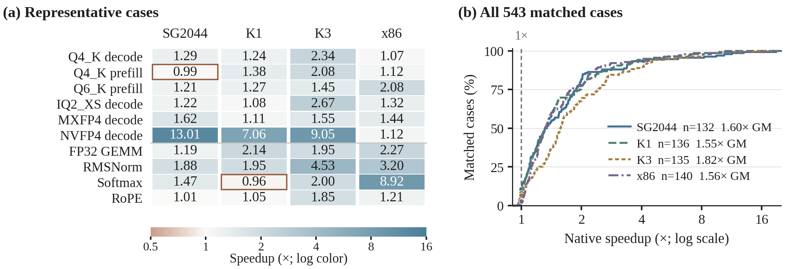
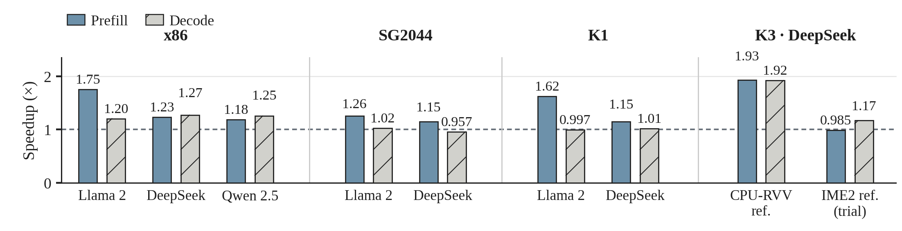

# Triton–Weft

**用 Triton 编写 CPU kernel，用 Weft 控制编码数据、计算分组与复用。**

[English](README.md) · [中文工具书](https://tianchen-ai.github.io/triton-weft/zh/) · [English handbook](https://tianchen-ai.github.io/triton-weft/) · [完整示例](examples/weft/README.zh-CN.md) · [实验结果](#实验与复现) · [实验复现](docs/weft/experiments/reproduce.zh.md)

Triton–Weft 扩展 Triton 的 Python 语言与编译器，面向 **RISC-V 和 x86 CPU**。
从熟悉的 `tl.load`、`tl.store`、归约和 `tl.dot` 开始；需要精细控制时，用
**Encoding** 描述打包存储，用 **Level** 组织逻辑计算，用 **state/stage** 表达累加与复用。
编译器保留这些关系，选择向量或矩阵指令、物理布局、局部存储和执行调度。

用户使用同一套 Triton 工作流：`@triton.jit(model="weft")`、`kernel[grid](...)`、
`triton.Config`、自动调优、编译缓存与原生导出。

[](docs/weft/assets/paper/compiler.png)

*Canonical IR 保存源程序的作用域、逻辑轴、状态和 Encoding；RISC-V 输出 intrinsic C
与局部汇编，x86 输出 LLVM IR。*

## 安装

在独立环境中安装本项目的 Triton 发行包：

```sh
python3 -m venv .venv
. .venv/bin/activate
python -m pip install --index-url https://tianchen-ai.github.io/triton-weft/wheels/ 'triton==3.8.0+weft.2'
python -m pip install numpy
```

[Release](https://github.com/Tianchen-ai/triton-weft/releases/tag/v3.8.0-weft.2)
提供 Linux x86-64 CPython 3.10 和 RISC-V CPython 3.11／3.12／3.14 wheel，
包含 Clang 23 与 OpenMP。[安装指南](docs/weft/getting-started/installation.zh.md)
说明系统要求，以及其他 Python 环境和当前 `main` 的源码构建方法。发行包名和导入名均为 `triton`。

## 运行第一个 kernel

将下面程序保存为 `affine.py`，执行 `python affine.py`：

```python
import numpy as np
import triton
import triton.language as tl

@triton.jit(model="weft")
def affine(X, Y, N, scale, bias, B: tl.constexpr):
    i = tl.program_id(0) * B + tl.arange(0, B)
    x = tl.load(X + i, mask=i < N, other=0.0)
    tl.store(Y + i, x * scale + bias, mask=i < N)

x = np.arange(131, dtype=np.float32)
y = np.empty_like(x)
compiled = affine[(triton.cdiv(x.size, 64),)](
    x, y, x.size, 1.25, -0.5, B=64, num_cpu_threads=2
)
print(y[:4])  # [-0.5, 0.75, 2.0, 3.25]
```

这里的 grid 包含三个独立程序实例，由两个 CPU 线程执行。最后一个实例用 mask
处理剩余三个元素。首次调用针对选定核心编译，后续调用复用 Triton 缓存。

## 把影响性能的结构写进程序

| 作者的选择 | Triton–Weft 表达 | 编译器获得的信息 |
|---|---|---|
| 打包字节与逻辑字段 | `@triton.encoding`、`tl.View` | 字段坐标、位宽、存储与对齐 |
| 逻辑分组与尾块 | `with tl.level.rows(...)`、`blocks(...)` | 哪些输出共享计算，以及覆盖范围 |
| 累加与复用 | `tl.state(...)`、`tl.stage(...)` | 初始化频率、跨迭代状态与共享值 |
| 数值分组 | `tl.mac_groups`、`tl.widen`、`tl.reduce` | 部分和位宽与转换边界 |
| 向量或矩阵计算 | `tl.dot(..., engine="vector" 或 "matrix")` | 当前 contraction 的实现类别约束 |

作者可以分别改变格式、数值分组和复用作用域；编译器通过共享分析与目标 passes
实现这些选择。[编程模型章节](docs/weft/programming-model/index.zh.md)
结合论文中的量化投影，逐步解释这些关系如何改变实际工作。

| 目标 | 向量路线 | 矩阵路线 |
|---|---|---|
| SG2044 | RVV，VLEN 128 | — |
| K1 | RVV，VLEN 256 | IME1 |
| K3 X100／A100 | RVV，VLEN 256／1024 | A100 上的 IME2 |
| x86 | AVX2／AVX-512、VNNI | Intel AMX INT8／BF16 |

`triton.cpu.target()` 构造编译目标；`triton.tools.cpu` 在 JIT 前选择执行核心。
具体操作见[目标、核心与 engine](docs/weft/getting-started/hardware.zh.md)。

## 从可运行示例学习

克隆仓库后，在已安装 wheel 的环境中，从仓库根目录运行：

```sh
python -m examples.weft.language.triton_basics --operation softmax
python -m examples.weft.language.encoding
python -m examples.weft.language.levels
python -m examples.weft.language.contraction --engine vector
python -m examples.weft.deployment.autotune_export /tmp/affine-artifact
```

[双语示例指南](examples/weft/README.zh-CN.md)说明输入、预期输出和可调整的源程序构造。
随后可以学习 [PyTorch](docs/weft/integrations/overview.zh.md)、
[原生 C++ 部署](docs/weft/compiler/native-sdk.zh.md)以及
[llama.cpp 接入](docs/weft/integrations/llama-cpp.zh.md)。

接入 llama.cpp 时，Triton 将 kernel 编译成带 typed ABI 的原生库，
adapter 把它绑定到匹配的 GGML 调用点，GGML worker 在推理中直接调用。
[完整教程](docs/weft/integrations/llama-cpp.zh.md)包括源码、导出、adapter 构建、加载与命中计数。

## 实验与复现

**论文中的算子和模型实验可以使用 Triton–Weft 与
[Triton–Weft Bench](https://github.com/Tianchen-ai/triton-weft-bench) 复现。**
Bench 提供作者程序、工作负载形状、参考库构建配方、模型协议、数值检查和计时入口。

[](docs/weft/assets/paper/operators.png)

*论文数据包含 553 个算子—平台案例，其中 543 项具有匹配的原生参考。
SG2044、K1、K3 A100 与 Xeon Platinum 8470Q 的几何平均加速分别为
1.60×、1.55×、1.82×、1.56×。分布图保留全部匹配案例。*

| 平台 | 正式用例 | 匹配原生比较 | 几何平均加速 |
|---|---:|---:|---:|
| SG2044 · RVV128 | 133 | 132 | **1.60×** |
| K1 · RVV256／IME1 | 137 | 136 | **1.55×** |
| K3 A100 · RVV1024／IME2 | 136 | 135 | **1.82×** |
| Xeon Platinum 8470Q · AVX-512／VNNI／AMX | 147 | 140 | **1.56×** |

倍率为参考耗时除以 Triton–Weft 耗时；匹配参考包含 541 项 GGML 和两项 oneDNN。
[完整算子测量 CSV](https://github.com/Tianchen-ai/triton-weft-bench/blob/main/docs/paper/operators.csv)。

[](docs/weft/assets/paper/models.png)

*九组配置覆盖 Llama 2 7B、DeepSeek 8B 与 Qwen 2.5 14B。
每组分别展示 prefill、decode 相对对应正常 llama.cpp 后端的收益；
K3 的 CPU–RVV 与厂商 IME2 使用各自的参考策略。*

| 平台 | 模型 | 参考 | Prefill | Decode |
|---|---|---|---:|---:|
| x86 | Llama 2 7B Q4_0 | 正常 llama.cpp | 1.75× | 1.20× |
| x86 | DeepSeek 8B Q4_K_M | 正常 llama.cpp | 1.23× | 1.27× |
| x86 | Qwen 2.5 14B Q4_K_M | 正常 llama.cpp | 1.18× | 1.25× |
| SG2044 | Llama 2 7B Q4_0 | 正常 llama.cpp | 1.26× | 1.02× |
| SG2044 | DeepSeek 8B Q4_K_M | 正常 llama.cpp | 1.15× | 0.957× |
| K1 | Llama 2 7B Q4_0 | 正常 llama.cpp | 1.62× | 0.997× |
| K1 | DeepSeek 8B Q4_K_M | 正常 llama.cpp | 1.15× | 1.01× |
| K3 A100 | DeepSeek 8B Q4_K_M | CPU–RVV | 1.93× | 1.92× |
| K3 A100 | DeepSeek 8B Q4_K_M | 厂商 IME2 | 0.985× | 1.17× |

模型均使用八线程。SG2044／K1／x86 为 128-token prefill、512-token context 后生成
32 tokens；K3 为 32-token prefill、32-token context 后生成 8 tokens。
[完整 18 个模型阶段 CSV](https://github.com/Tianchen-ai/triton-weft-bench/blob/main/docs/paper/models.csv)。

先查看用例，再使用配置好的目标运行：

```sh
git clone https://github.com/Tianchen-ai/triton-weft-bench.git
cd triton-weft-bench
python -m pip install '.[verification]'
mkdir -p .local
cp configs/example.json .local/bench.local.json
export WEFT_BENCH_CONFIG="$PWD/.local/bench.local.json"
# 按目标配置指南填写目标、连接方式和参考库。
weft-bench list --kind suites --target k1
weft-bench show q4_k_dot --target k1
weft-bench op q4_k_dot --target k1 --output output/current/k1/q4_k_dot
```

[复现章节](docs/weft/experiments/reproduce.zh.md)给出全量套件、目标机 JIT、固定参考、
模型 package 和结果文件的操作步骤。[结果与图片来源](docs/weft/experiments/results.zh.md)
说明论文采用的测量快照及计时范围。

## 项目结构

| 模块 | 位置 |
|---|---|
| 语言与共同 Triton 前端 | `python/triton/language`、`python/triton/compiler` |
| JIT、CPU backend 与原生加载 | `python/triton/runtime`、`python/triton/backends/weft` |
| Canonical IR 与共享分析 | `third_party/weft/lib/Dialect/Kernel`、`third_party/weft/lib/Analysis` |
| RISC-V／x86 物理编译 | `third_party/weft/lib/Target/RISCV`、`third_party/weft/lib/Target/X86` |
| 原生 runtime 与应用 adapter | `third_party/weft/lib/Runtime`、`integrations` |
| 可运行教程／双语工具书 | `examples/weft`、`docs/weft` |
| 详细设计合同 | `docs/specification` |

本仓库 fork 自 [Triton v3.8.0](https://github.com/triton-lang/triton/tree/v3.8.0)，
`main` 是产品主分支。[上游修改地图](docs/weft/development/upstream.zh.md)
列出各扩展接缝；开发 pass 或新增硬件扩展可从[贡献指南](CONTRIBUTING.md)开始。

上游 Triton 保留 MIT 许可证，Weft 扩展保留 Apache-2.0；
[NOTICE](NOTICE) 记录组件归属。
