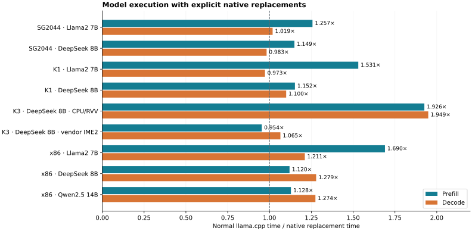

# Triton–Weft

[English](README.md) · [工具书](https://tianchen-ai.github.io/triton-weft/) ·
[示例指南](docs/weft/getting-started/examples.md) ·
[Weft Bench](https://github.com/Tianchen-ai/triton-weft-bench)

Triton–Weft 在 Triton 中加入面向 RISC-V 与 x86 CPU 的编程模型与编译路线。
普通程序继续使用 `tl.load/store`、广播、归约、`tl.dot`、scan 和 atomic；
需要精确表达量化存储、有限位宽和跨层复用时，可以组合 Encoding、View、Level、state/stage。
同一前端形成 Canonical IR：RISC-V passes 生成 RVV/IME intrinsic C 与局部汇编，
x86 passes 生成 SIMD/AMX 的 LLVM IR。

用户使用同一份 `import triton`、JIT、autotune、编译缓存与原生产物。
CPU Tensor 可以直接传入；导出的 native 库可由现有 C/C++ 线程池调用，也可用于 llama.cpp。
上游 Triton 的 GPU 路线保留。这是基于上游 v3.8.0 的正式 fork，`main` 为产品分支；
[上游修改说明](docs/weft/development/upstream.md)列明前端、JIT、构建与目标编译接缝。

## 开始使用

本项目是一份定制 Triton，普通 `pip install triton` 不包含 Weft 扩展。
请按[安装指南](docs/weft/getting-started/installation.md)在独立环境构建，
使用匹配的 LLVM/MLIR SDK、Clang 与目标 ABI。一个环境只安装一份提供 `triton` 模块的发行包。

```python
import numpy as np
import triton
import triton.language as tl

@triton.jit(model="weft")
def affine(X, Y, N, scale, B: tl.constexpr):
    offsets = tl.program_id(0) * B + tl.arange(0, B)
    active = offsets < N
    x = tl.load(X + offsets, mask=active, other=0.0)
    tl.store(Y + offsets, x * scale, mask=active)

x = np.arange(131, dtype=np.float32)
y = np.empty_like(x)
affine[(triton.cdiv(x.size, 64),)](x, y, x.size, 1.25, B=64, num_cpu_threads=2)
print(y[:8])
```

将程序保存为 Python 文件，在支持的 RISC-V 或 x86 主机上运行。
grid 表达独立实例的数据分区，`num_cpu_threads` 控制 OpenMP 线程数；两者各自独立。
mask 为假的元素不发生访存。`CompiledKernel.asm` 可检查语义 IR、物理 IR、C 和原生库。

从仓库根目录运行正式示例：

```sh
python -m examples.weft.language.triton_basics --operation softmax
python -m examples.weft.language.triton_basics --operation matmul
python -m examples.weft.language.triton_basics --operation scan
python -m examples.weft.language.triton_basics --operation histogram
python -m examples.weft.deployment.autotune_export /path/to/new/artifact
```

PyTorch 图接入先按安装指南运行一次 `python -m triton.tools.pytorch`，
再使用正常 Triton kernel 调用及 `torch.compile(..., options={"cpu_backend": "triton"})`。
完整用法见[示例指南](docs/weft/getting-started/examples.md)和[框架接入](docs/weft/integrations/overview.md)。

每个 contraction 可以指定 `engine="vector"` 或 `engine="matrix"`，默认合法矩阵优先。
`triton.cpu.target()` 声明编译能力，`triton.tools.cpu` 负责注册和绑定实际执行核心。
详见[目标与核心选择](docs/weft/getting-started/hardware.md)和
[完整 llama.cpp 部署链路](docs/weft/integrations/llama-cpp.md)。

## 文档与开发

- [工具书入口](docs/weft/index.md)：安装、语言、编译器、应用与扩展。
- [Encoding 与存储](docs/weft/dsl/encoding-and-artifacts.md)。
- [Level 与生命周期](docs/weft/dsl/values-and-levels.md)。
- [JIT、调优、缓存和 AOT](docs/weft/compiler/runtime.md)。
- [原生 SDK 与 llama.cpp](docs/weft/compiler/native-sdk.md)。
- [RISC-V 扩展合同](docs/weft/development/extensions.md)。
- [贡献指南](CONTRIBUTING.md)。

编译器、运行时和使用示例在本仓库；数值检查、benchmark、设备配置和实验输出由独立 Weft Bench 管理。

## 实测模型性能



图中比较正常 llama.cpp 与加载原生替换包后的真实模型执行，prefill/decode 分开计时。
保留的完整记录包括 K1 Llama2 prefill **1.531×** 和 x86 Llama2 prefill **1.690×**；
部分阶段仍接近持平。K3 的 CPU/RVV 与厂商 IME2 是两种独立 baseline，约 1.95× 的
CPU/RVV 结果不能当作超越厂商矩阵后端的倍率。这些数字没有叠加单算子收益。

覆盖 Llama2 7B Q4_0、DeepSeek-R1-Distill-Llama 8B Q4_K_M，以及 x86 的 Qwen2.5 14B Q4_K_M。
编译和加载不计入窗口；记录保留数值检查和替换计数。
[模型协议](https://github.com/Tianchen-ai/triton-weft-bench/blob/main/src/weft_bench/catalogs/models.json)
列出每个场景的长度、线程、重复次数和正常后端，
[图中数据](https://github.com/Tianchen-ai/triton-weft-bench/releases/download/v0.4.0/model-results.json)
来自重构前已测的选定产物。本轮整理保留这些记录，不将目录迁移算成新的性能收益。

## 来源与许可证

Triton 基于上游 3.8.0，保留 MIT 许可证；Weft 编译器、语言与运行时保留 Apache-2.0。
[NOTICE](NOTICE) 列出组件归属和第三方许可。本扩展由本仓库维护。
