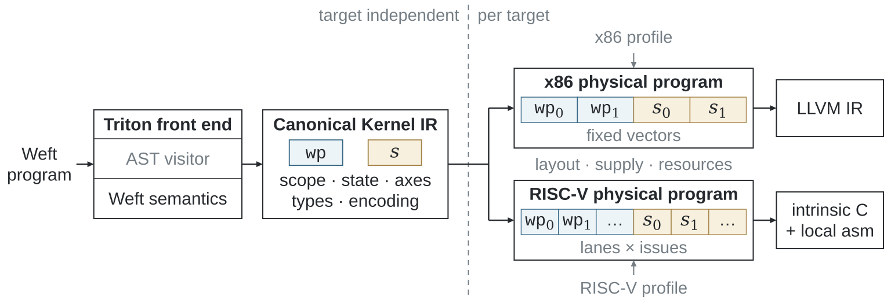

# 编译管线

共同 Triton 前端构造保留 Weft 逻辑关系的 Canonical 程序；
目标 passes 将其实现为可执行的物理表示，最终 emitter 翻译已经确定的表示。

## 跟随一个 kernel

| 阶段 | 保留或增加的信息 | 查看入口 |
|---|---|---|
| Triton 前端 | 类型、表达式、控制流、Encoding、Level 初始化与 SSA carry | 源码诊断 |
| Canonical Kernel IR | 逻辑轴、数值位宽、存储 effects、state/stage 归属 | `asm["weftir"]` |
| 共享分析 | 整数事实、轴、索引关系、存储跨度、alias 与生命周期 | 物理 pass 决定 |
| RISC-V 物理编译 | lane/time/replica 放置、局部存储、RVV/IME 操作、调度与资源 | `asm["riscvir"]` |
| x86 物理编译 | SIMD packet、矩阵操作数、局部 buffer、AMX 资源与 LLVM 转换 | `asm["x86ir"]` |
| 代码生成 | intrinsic C／局部汇编，或 LLVM IR | `asm["c"]`／`asm["llir"]` |
| 原生编译与加载 | 动态库、typed ABI 和执行要求 | `asm["so"]`、导出的 manifest |

两个目标共享作者语义与分析。目标物理表示保存运行该程序所需的具体决定。
例如 staged panel 可以放入寄存器或局部 packed storage，
源程序的初始化和共享作用域在这一过程中保持明确。

## 阅读与开发

- [Canonical IR](../dsl/canonical-ir.md)：作者程序的 typed contract。
- [物理表示](physical-machine.md)：lane、packet、fragment 与存储。
- [Passes](passes.md)：分析、选择、物化与验证。
- [RISC-V](riscv-ir.md) 与 [x86](x86.md)：两个目标的物理实现。
- [代码生成](emission.md)：形成原生工具链输入。

[源码地图](../development/upstream.md)对应这些职责与目录；
[完整编译器规格](https://github.com/Tianchen-ai/triton-weft/blob/main/docs/specification/compiler/index.md)
规定开发中使用的 Canonical→Physical 边界。
