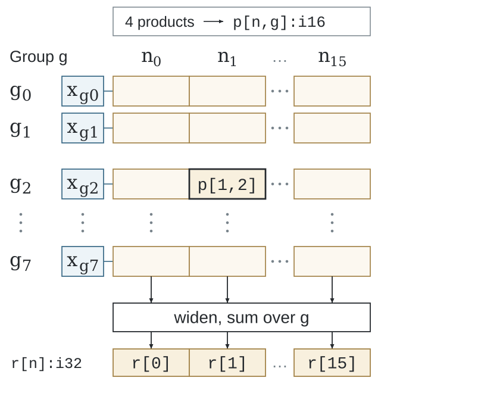
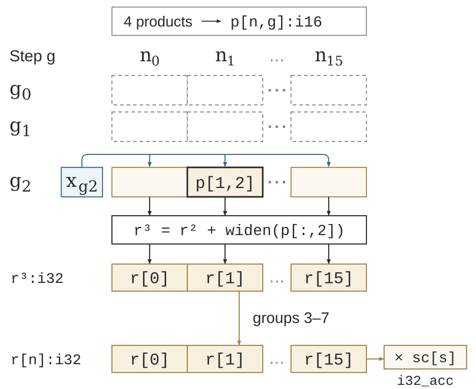

# Physical representation

A logical Value may be larger than one machine vector or matrix fragment.
The physical program maps its coordinates to storage and execution while retaining
the source program's numerical and lifetime relationships.

Both views follow the same output and reduction coordinates. Mapping changes
execution placement while preserving each result's updates.

## Physical building blocks

| Concept | Role |
|---|---|
| Lane | Elements processed together by one vector operation |
| Issue/time dimension | Portions of a logical domain executed in successive operations |
| Replica | Independent physical groups covering free coordinates |
| Packet or fragment | A target representation consumed by vector or matrix instructions |
| Local storage | Invocation-private snapshots, packing or spilled values |
| Conversion | Explicit transfer between producer and consumer representations |
| Valid domain | Logical coordinates active in a full or partial operation |

The compiler can partition free coordinates into several packets, supply a shared
Value to several consumers, or widen partials before reduction. It retains the
author's source group and scope while choosing those representations.

An indexed field access can denote a contiguous window of a saved encoded
record. A positional tile may give that window another axis name. Memory
planning proves the nonwrapping coordinate interval, reads on the field's
source axis, and records the result rename as an explicit representation edge.
The index expression does not require a numeric scratch array. The read keeps
its original snapshot and active domain. Byte-carried Boolean values use dense
byte transfers; a packed mask retains its separate bit-storage contract.

A grouped read from a one-dimensional numeric snapshot can also produce a scalar.
The representation pass saves the original Value once and selects the scalar from
that private storage using the sub-Level's relative group coordinate. Scalar and
shaped consumers therefore retain the same read point and lifetime; selecting a
group does not reread the encoded source.

Bounded lookups on a one-axis encoded payload field retain that field's physical supply
edge, so a regular coordinate pattern can use strided or segment memory access.
Interleaved scalar-per-record cohorts use their existing byte-safe field transfer
when a positional rename needs a numeric value. Both choices retain the original
read epoch and its alias checks.
Affine supply analysis retains coordinate relations across value-preserving
integer casts and complete row-major reshape splits. The shared integer range
proof must exclude wrapping or saturation; non-affine reshapes retain their
explicit conversion. This lets storage planning consume the original Encoding
relation without creating an index array solely because its axes were renamed.
Scalar-per-record fields retain their outer record coordinates; selecting a
record cannot become an element offset inside its scalar metadata word.
Single-consumer integer fragment arithmetic also remains in fragment storage
across a positional axis rename. The pass calculates in the original coordinates
and restores the numeric result's axes at the exit, preserving explicit births.

## Resource analysis

The target profile supplies vector width, register facts, supported instructions
and policy budgets. Analysis of the current SSA program determines live Values,
temporary representations, packing storage and spill/reload demand.

The resource pass checks the materialized program. A legal finite candidate can
be reselected when its complete representation exceeds a budget. LLVM or the
target C toolchain performs final machine register allocation and instruction scheduling.

## Two target representations

RISC-V uses custom physical types and operations for RVV and IME. x86 uses upstream
MLIR vector, memref, SCF, arithmetic and LLVM operations with target-specific
selection and resource analysis.

Read [RISC-V IR](riscv-ir.md), [x86 compilation](x86.md), and the
[complete physical-machine contract](https://github.com/Tianchen-ai/triton-weft/blob/main/docs/specification/compiler/physical-machine.md).
