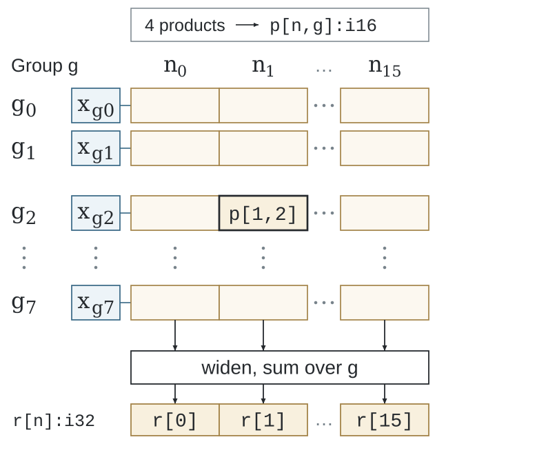
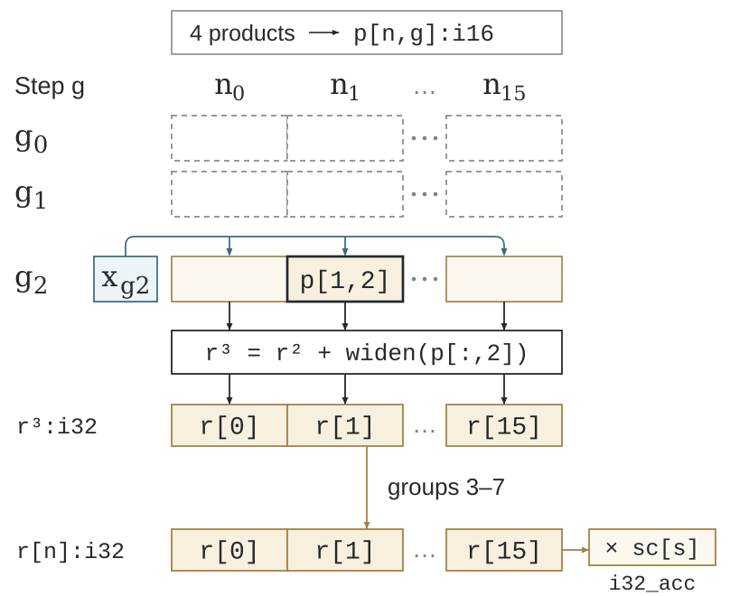

# 物理表示

一个逻辑 Value 可以大于单条机器向量或矩阵 fragment。
物理程序将其坐标映射到存储与执行，同时保留源程序的数值和生命周期关系。

两图沿用相同输出与归约坐标，映射改变执行位置，保留各结果的更新关系。

## 物理组成

| 概念 | 作用 |
|---|---|
| Lane | 一次向量操作共同处理的元素 |
| Issue／time 维 | 通过连续操作执行的逻辑域部分 |
| Replica | 覆盖独立 free coordinate 的物理组 |
| Packet 或 fragment | 向量或矩阵指令消费的目标表示 |
| 局部存储 | 调用私有的快照、packing 或 spill |
| Conversion | 生产者与消费者表示间的显式转换 |
| 有效域 | 完整或尾部操作中有效的逻辑坐标 |

编译器可将 free coordinate 分成多个 packet，为多个消费者供应共享 Value，
也可在归约前提升 partial 位宽；这些表示选择保留作者的源级分组和作用域。

字段的索引访问可能表示已保存 encoded record 的连续窗口，位置型 tile 可以为该窗口
使用另一个轴名。访存规划先证明坐标区间不回绕，在字段的源轴上读取，再以显式表示边
记录结果改名，无需将索引表达式物化成数值临时数组。读取保留原快照与有效域。
以字节承载的 Boolean 使用普通字节传输；packed mask 仍遵循独立的位存储合同。

一维数值快照的分组读取也可以得到标量。表示 pass 只保存一次原 Value，
再使用子 Level 的相对分组坐标从私有存储中选择标量。标量与 shaped 消费者保持
相同的读取时点和生命周期；选择分组不会重新读取 encoded 源存储。

一维 encoded payload field 的有界 lookup 保留字段的物理供给边，使规则坐标能够使用
strided 或 segment 访存。interleave 中逐 record 标量字段的 cohort 在坐标改名
需要数值结果时，复用已有的字节安全字段传输；两者都保留原读取 epoch 和别名检查。
Affine 供给分析保留数值不变的整数转换及完整 row-major reshape 拆分的坐标关系，
转换须由共同整数范围证明排除回绕或饱和；非 affine reshape 仍保留显式转换。
字段规划因此能够继续消费原 Encoding 关系，不因坐标改名而单独物化索引数组。
逐 record 标量字段保留外层 record 坐标；选择 record 不能变成标量 metadata 内的元素偏移。
单消费者的整数 fragment 运算也可跨越纯位置轴改名：先按原坐标计算，在数值出口恢复
结果轴，保留显式 birth，使已有 fragment pointwise 与 MMA 累加器复用继续生效。

## 资源分析

目标 profile 提供向量宽度、架构寄存器事实、支持指令与策略预算。
当前 SSA 程序的分析决定活跃 Value、临时表示、packing 存储和 spill/reload 需求。

资源 pass 检查真实物化后的程序。当完整表示超出预算时，可以在有限合法候选中重新选择。
最终机器寄存器分配与指令调度由 LLVM 或目标 C 工具链完成。

## 两种目标表示

RISC-V 使用面向 RVV 与 IME 的自定义物理类型和操作；
x86 使用上游 MLIR vector、memref、SCF、arith 与 LLVM 操作，
配合自身的目标选择和资源分析。

继续阅读 [RISC-V IR](riscv-ir.md)、[x86 编译](x86.md)及
[完整物理机器合同](https://github.com/Tianchen-ai/triton-weft/blob/main/docs/specification/compiler/physical-machine.md)。
