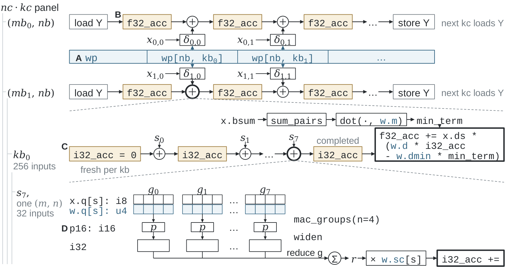

# 把示例读成完整程序

[可运行教程](../getting-started/examples.md)依次介绍普通 Triton、存储、复用与部署。
本章把源码和含义对应起来，并给出值得尝试的修改。

## Encoding：同一组值的两种表示

`language/encoding.py` 的宿主将 32 个逻辑 U4 打包为 16 字节，
声明告诉编译器每个字段元素的位置。Kernel 读取 record，
访问 `record.q`，再 widen 为 U8 输出。

跟踪一个坐标：逻辑元素 20 读取字节 4 的高 nibble。
改变数值是在改变输入；改变 `bit_layers` 则改变存储合同及相应宿主准备。
改变算术表达式决定如何使用这些相同字段计算。

## Level：在 block 更新之间共享一行

`language/levels.py` 中，row 持有一份输入快照和一个 accumulator。
内层 block Level 读取对应切片，贡献其平方和；
最后的部分 block 沿用同一逻辑覆盖和状态。

修改 source 参数 `B` 可改变逻辑分组，
再查看 `weftir` 与目标 IR，观察编译器怎样实现所选分组。
`tl.stage` 标记共享值，其物理驻留在后续阶段决定。

## Contraction：类型与 engine

`language/contraction.py` 用普通指针运算构造两个 I8 矩阵块，
`tl.dot` 产生 I32 结果。`ENGINE` 是传给 contraction 的 constexpr。
先比较 `vector` 与 `auto`，再在支持合法整数矩阵路线的目标上选择 `matrix`，
并读取程序打印的实际扩展。

## 从教程到优化 corpus

论文中的 projection 在更大范围组合这些能力：
编码权重字段、显式 partial 位宽、共享 panel 和嵌套输出 state。
对应作者程序位于可安装的 Bench package。

[模型程序](programs.md)提供 corpus 地图；
[物理优化](../compiler/optimization-principles.md)说明如何区分 DSL 改进和编译器改进。
