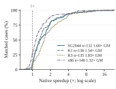
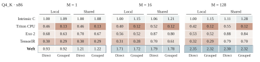
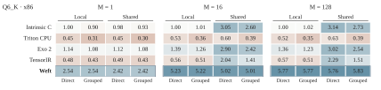
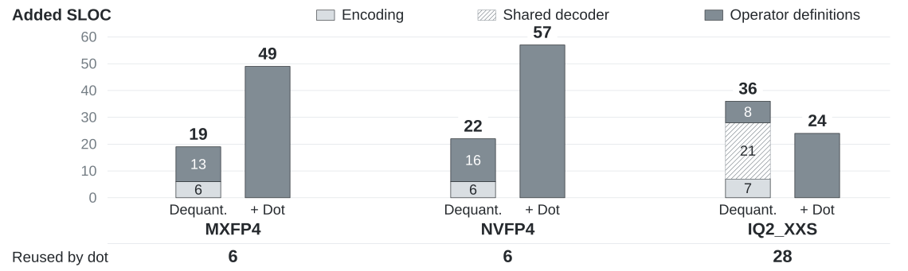
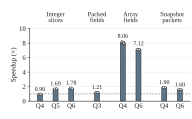
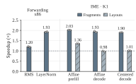

# Performance, control and reuse

These selected paper results follow the model's purpose: high performance,
composable author control and reusable compilation. **[Triton–Weft Bench](https://github.com/Tianchen-ai/triton-weft-bench)**
hosts the [complete result gallery, paper Figures 9–20](https://tianchen-ai.github.io/triton-weft-bench/paper/gallery/)
and all sixteen CSV tables. The [reproduction workflow](reproduce.md) connects
the installed product with matching workloads and references.

Speedup divides reference time by Weft time; compiler interventions divide
disabled time by enabled time. Each figure identifies its own comparison.

## Native operator performance

| Platform | Cases | Matched comparisons | Geometric mean |
|---|---:|---:|---:|
| SG2044, RVV128 | 133 | 132 | 1.60× |
| K1/X60, RVV256 and IME | 137 | 136 | 1.54× |
| K3/A100, RVV1024 and IME2 | 136 | 135 | 1.83× |
| Xeon Platinum 8470Q, AVX-512/VNNI/AMX | 147 | 140 | 1.32× |

The distributions include all 543 matched cases. Optimized GGML supplies the
principal references and oneDNN supplies two BF16/INT8 dense references.
Complete projections include activation preparation; microkernels consume
prepared operands. The `scope` column identifies each timed interface.

## Complete inference

Eight model/platform deployments cover Llama 2 7B, DeepSeek 8B and Qwen 2.5 14B.
The 18 phase comparisons include both K3 vendor IME2 and CPU-vector references.
SG2044 uses **64 threads**; K1, K3 and x86 use **eight**.

SG2044/K1/x86 measure 128-token prefill and 32-token decode after a 512-token
context. K3 measures 32-token prefill and eight-token decode after 32 tokens.
Pairs fix models, weights, shapes and threads. Application CSVs record the
numerical checks and process aggregation.

## Author control and source reuse

The Q4_K and Q6_K studies compare intrinsic C, Triton CPU, Exo 2, TensorIR and
Weft on complete projections at `M=1,16,128`, `N=256`, `K=4096`. Each route
implements local/shared preparation crossed with direct/grouped accumulation.
The reference is intrinsic C local/direct at each shape, and activation
quantization is inside the timed call.

[Control measurements](https://github.com/Tianchen-ai/triton-weft-bench/blob/main/docs/paper/author-controls.csv)
and [selected bindings](https://github.com/Tianchen-ai/triton-weft-bench/blob/main/docs/paper/five-route-bindings.csv)
record the full calls and configurations. Bench separately presents
[same-compiler arithmetic and state choices](https://tianchen-ai.github.io/triton-weft-bench/paper/gallery/#arithmetic-organization-and-output-state).

New formats also reuse source definitions. MXFP4, NVFP4 and IQ2_XXS first add
dequantization, then dot. Encoding and decoder definitions established by the
first operator serve the second; the bars separate them from newly added
operator code.

[The state and evolution studies](https://tianchen-ai.github.io/triton-weft-bench/paper/gallery/#source-increments-and-reuse)
connect these source changes with complete attention and Welford programs.

## Source relationships drive compilation

The compiler uses field geometry to load and decode prepared data, value uses
to forward arrays, and state scopes to keep matrix fragments live. These
experiments fix the author program and Canonical operations, types and regions,
then disable one physical mechanism at a time.

| Encoding and consumption | Value forwarding and matrix state |
|---|---|
|  |  |

Bars give geometric means of two process ratios; dots show each process and
whiskers its paired-batch interquartile range. [Compiler measurements](https://github.com/Tianchen-ai/triton-weft-bench/blob/main/docs/paper/compiler-mechanisms.csv)
preserve the paired observations. The [complete mechanism results](https://tianchen-ai.github.io/triton-weft-bench/paper/gallery/#source-bounds-through-target-construction)
also show range-guided execution on RISC-V and source-range propagation on x86.

## Final tables

| Table | Rows | Evidence |
|---|---:|---|
| [operators.csv](https://github.com/Tianchen-ai/triton-weft/blob/main/results/operators.csv) | 553 | All operator/target cases and matched times |
| [operator-families.csv](https://github.com/Tianchen-ai/triton-weft/blob/main/results/operator-families.csv) | 5 | Family counts and geometric means |
| [applications.csv](https://github.com/Tianchen-ai/triton-weft/blob/main/results/applications.csv) | 18 | Complete inference phases and reference policies |
| [application-x86-windows.csv](https://github.com/Tianchen-ai/triton-weft/blob/main/results/application-x86-windows.csv) | 120 | x86 per-process stage observations |
| [application-roles.csv](https://github.com/Tianchen-ai/triton-weft/blob/main/results/application-roles.csv) | 18 | Computation and preparation role effects |
| [fp32-libraries.csv](https://github.com/Tianchen-ai/triton-weft/blob/main/results/fp32-libraries.csv) | 12 | FP32 GEMM against three libraries |
| [grid.csv](https://github.com/Tianchen-ai/triton-weft/blob/main/results/grid.csv) | 48 | Complete calls on 1/2/4/8 threads |
| [ggml-compute.csv](https://github.com/Tianchen-ai/triton-weft/blob/main/results/ggml-compute.csv) | 32 | Computation inside GGML workers |
| [author-controls.csv](https://github.com/Tianchen-ai/triton-weft/blob/main/results/author-controls.csv) | 240 | Five-route sharing and precision controls |
| [author-organization.csv](https://github.com/Tianchen-ai/triton-weft/blob/main/results/author-organization.csv) | 48 | Arithmetic and output-state scope |
| [five-route-bindings.csv](https://github.com/Tianchen-ai/triton-weft/blob/main/results/five-route-bindings.csv) | 30 | Selected task bindings |
| [format-addition.csv](https://github.com/Tianchen-ai/triton-weft/blob/main/results/format-addition.csv) | 5 | Q4 construction and Q6 source increments |
| [state-algorithms.csv](https://github.com/Tianchen-ai/triton-weft/blob/main/results/state-algorithms.csv) | 36 | Attention and Welford organizations |
| [compiler-mechanisms.csv](https://github.com/Tianchen-ai/triton-weft/blob/main/results/compiler-mechanisms.csv) | 214 | Paired physical mechanisms |
| [increment-costs.csv](https://github.com/Tianchen-ai/triton-weft/blob/main/results/increment-costs.csv) | 3 | Format/operator added and reused SLOC |
| [increment-definitions.csv](https://github.com/Tianchen-ai/triton-weft/blob/main/results/increment-definitions.csv) | 18 | Individual source definitions for the reuse figure |

Control tasks compare complete calls in intrinsic C, Triton CPU, Exo 2,
TensorIR and Weft. State studies compare sequential and blocked organizations;
compiler studies fix source semantics and change physical mechanisms.
Sample columns preserve batch observations; ratios use unrounded values.

## Diagram and dataset provenance

Current vector figures explain shared fields and state, common/target
compilation, state partition, logical/physical layouts and encoding reuse.
Their names identify their roles.
The [provenance manifest](https://github.com/Tianchen-ai/triton-weft/blob/main/results/provenance.json) records the paper source
revision, original figure paths, hashes, row counts and thread settings.
Product and Bench CSV copies match this snapshot. The
[Bench dataset guide](https://github.com/Tianchen-ai/triton-weft-bench/blob/main/docs/paper/README.md)
explains the columns and timing boundaries.
