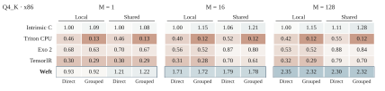
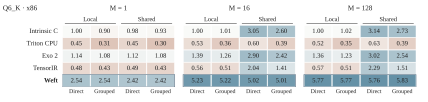
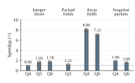
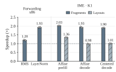

# 性能、控制与复用

本页精选论文中连接高性能、作者控制与编译复用的结果。
**[Triton–Weft Bench](https://github.com/Tianchen-ai/triton-weft-bench)** 提供
[完整结果图集（论文图 9–20）](https://tianchen-ai.github.io/triton-weft-bench/zh-CN/paper/gallery/)
与十六份 CSV。[复现流程](reproduce.md)连接安装后的产品、匹配工作负载和参考实现。

加速比为参考耗时除以 Weft 耗时；机制实验使用关闭耗时除以开启耗时。
各图分别说明采用的比较基准。

## 原生算子性能

| 平台 | 案例 | 匹配比较 | 几何平均 |
|---|---:|---:|---:|
| SG2044, RVV128 | 133 | 132 | 1.60× |
| K1/X60, RVV256 and IME | 137 | 136 | 1.54× |
| K3/A100, RVV1024 and IME2 | 136 | 135 | 1.83× |
| Xeon Platinum 8470Q, AVX-512/VNNI/AMX | 147 | 140 | 1.32× |

分布覆盖全部 543 项匹配案例，主要参考是优化的 GGML，
oneDNN 提供两项 BF16/INT8 稠密参考。
完整投影包含激活准备；微内核消费已准备操作数，`scope` 说明各调用边界。

## 完整推理

八组模型—平台部署覆盖 Llama 2 7B、DeepSeek 8B 与 Qwen 2.5 14B。
18 项阶段比较同时展示 K3 的厂商 IME2 与 CPU 向量参考。
SG2044 使用 **64 线程**，K1、K3 和 x86 使用 **八线程**。

SG2044/K1/x86 测量 128-token prefill，以及 512-token 上下文后的
32-token decode；K3 测量 32-token prefill，以及 32-token 上下文后的八 token decode。
每个配对固定模型、权重、形状与线程，应用 CSV 记录正确性和进程聚合。

## 作者控制与源码复用

Q4_K 与 Q6_K 研究让 intrinsic C、Triton CPU、Exo 2、TensorIR 和 Weft 实现完整投影，
固定 `M=1,16,128`、`N=256`、`K=4096`。每条路线组合局部／共享准备与直接／分组累加。
各形状以 intrinsic C 局部／直接版本为参考，激活量化计入完整调用。

[控制测量](https://github.com/Tianchen-ai/triton-weft-bench/blob/main/docs/paper/author-controls.csv)与
[选定绑定](https://github.com/Tianchen-ai/triton-weft-bench/blob/main/docs/paper/five-route-bindings.csv)
记录完整调用及配置。Bench 另行展示[同一编译器下的算术和状态选择](https://tianchen-ai.github.io/triton-weft-bench/zh-CN/paper/gallery/#算术组织与输出状态)。

新增格式也复用已有定义。MXFP4、NVFP4 和 IQ2_XXS 先加入反量化，再加入 dot。
第一个算子建立的 Encoding 和解码器继续服务第二个算子；图中将它们与新增算子代码分开。

[状态与演进研究](https://tianchen-ai.github.io/triton-weft-bench/zh-CN/paper/gallery/#源码增量与复用)
把这些源码变化与完整注意力、Welford 程序连接起来。

## 源程序关系驱动编译

编译器利用字段几何直接加载、解码准备好的数据，利用值的使用关系转发数组，
利用状态范围保留矩阵片段。这些实验固定作者程序和 Canonical 运算、类型及区域，
每次关闭一项物理机制。

| Encoding 与消费 | 值转发与矩阵状态 |
|---|---|
|  |  |

柱表示两个进程倍率的几何平均，点为各进程结果，线段为配对批次的四分位范围。
[编译器数据](https://github.com/Tianchen-ai/triton-weft-bench/blob/main/docs/paper/compiler-mechanisms.csv)
保留配对观察。[完整机制结果](https://tianchen-ai.github.io/triton-weft-bench/zh-CN/paper/gallery/#数值范围贯穿目标构造)
还展示 RISC-V 的范围引导执行和 x86 的源范围传播。

## 最终数据表

| 表格 | 行数 | 内容 |
|---|---:|---|
| [operators.csv](https://github.com/Tianchen-ai/triton-weft/blob/main/results/operators.csv) | 553 | 全部算子—平台案例与匹配耗时 |
| [operator-families.csv](https://github.com/Tianchen-ai/triton-weft/blob/main/results/operator-families.csv) | 5 | 类别数量与几何平均 |
| [applications.csv](https://github.com/Tianchen-ai/triton-weft/blob/main/results/applications.csv) | 18 | 完整推理阶段与参考策略 |
| [application-x86-windows.csv](https://github.com/Tianchen-ai/triton-weft/blob/main/results/application-x86-windows.csv) | 120 | x86 分进程阶段测量 |
| [application-roles.csv](https://github.com/Tianchen-ai/triton-weft/blob/main/results/application-roles.csv) | 18 | 计算和准备阶段的作用 |
| [fp32-libraries.csv](https://github.com/Tianchen-ai/triton-weft/blob/main/results/fp32-libraries.csv) | 12 | FP32 GEMM 对比三个库 |
| [grid.csv](https://github.com/Tianchen-ai/triton-weft/blob/main/results/grid.csv) | 48 | 1/2/4/8 线程完整调用 |
| [ggml-compute.csv](https://github.com/Tianchen-ai/triton-weft/blob/main/results/ggml-compute.csv) | 32 | GGML 工作线程内计算 |
| [author-controls.csv](https://github.com/Tianchen-ai/triton-weft/blob/main/results/author-controls.csv) | 240 | 五路线的共享与精度控制 |
| [author-organization.csv](https://github.com/Tianchen-ai/triton-weft/blob/main/results/author-organization.csv) | 48 | 算术与输出状态范围 |
| [five-route-bindings.csv](https://github.com/Tianchen-ai/triton-weft/blob/main/results/five-route-bindings.csv) | 30 | 选定任务绑定 |
| [format-addition.csv](https://github.com/Tianchen-ai/triton-weft/blob/main/results/format-addition.csv) | 5 | Q4 构造和新增 Q6 的源码增量 |
| [state-algorithms.csv](https://github.com/Tianchen-ai/triton-weft/blob/main/results/state-algorithms.csv) | 36 | 注意力与 Welford 组织 |
| [compiler-mechanisms.csv](https://github.com/Tianchen-ai/triton-weft/blob/main/results/compiler-mechanisms.csv) | 214 | 配对物理编译机制 |
| [increment-costs.csv](https://github.com/Tianchen-ai/triton-weft/blob/main/results/increment-costs.csv) | 3 | 各格式／算子新增与复用 SLOC |
| [increment-definitions.csv](https://github.com/Tianchen-ai/triton-weft/blob/main/results/increment-definitions.csv) | 18 | 复用图的具体源码定义 |

控制任务比较 intrinsic C、Triton CPU、Exo 2、TensorIR 与 Weft 的完整调用。
状态研究比较顺序与分块组织；编译器研究固定源语义、改变物理机制。
样本列保留各批次测量，倍率使用未舍入值计算。

## 图件与数据来源

当前矢量图解释共享字段与状态、共同层与目标编译、状态划分、
逻辑/物理布局和 Encoding 复用，按用途命名。
[来源清单](https://github.com/Tianchen-ai/triton-weft/blob/main/results/provenance.json)记录论文源码版本、原图路径、
文件哈希、行数与线程设置。产品和 Bench 的 CSV 副本来自相同快照。
[Bench 数据指南](https://github.com/Tianchen-ai/triton-weft-bench/blob/main/docs/paper/README.zh-CN.md)
解释各列与计时边界。
