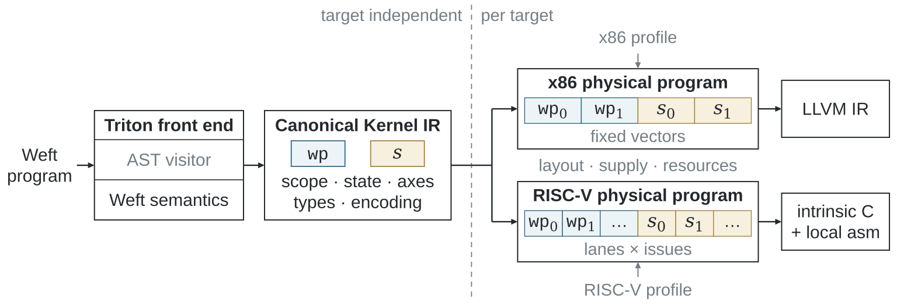

# Triton–Weft 1.0 handbook

Weft lets CPU kernel authors compose data representation, local arithmetic,
shared preparation and state evolution in one program. Its Triton frontend
preserves those choices through a common Canonical IR, then constructs native
vector and matrix execution for x86 and RISC-V.

## Start with a complete program

[Install Weft](getting-started/installation.md) and run the
[quickstart](getting-started/quickstart.md). It uses typed Views, a staged input
and a state updated across blocks. Continue with complete Q4_K projection,
online attention, Welford statistics and GEMM in the
[runnable examples](getting-started/examples.md).

| Your next task | Read |
|---|---|
| Express storage and numerical choices | [Programming model](programming-model/index.md), [Encoding](dsl/encoding-and-artifacts.md), [operations](dsl/functions-and-operations.md) |
| Compose sharing and state | [Level and state](dsl/values-and-levels.md), [model programs](dsl/programs.md) |
| Select cores and execution engines | [Targets and engines](getting-started/hardware.md) |
| Tune and deploy | [JIT and autotune](compiler/runtime.md), [native C/C++](compiler/native-sdk.md), [llama.cpp](integrations/llama-cpp.md) |
| Reproduce measurements | [Bench workflow](experiments/reproduce.md), [results and data](experiments/results.md) |
| Develop the compiler | [Pipeline](compiler/index.md), [passes](compiler/passes.md), [source map](development/upstream.md) |

Use the language selector for the corresponding English or Chinese chapter.
Both editions use `import triton.language as tl`.

## From source relationships to native execution

The author writes `@triton.jit(model="weft")` and launches with
`kernel[grid](...)`. Typed fields, numerical groups, sharing and state remain
explicit during compilation. Target passes choose vector layouts, matrix
fragments and local storage. The runtime supports JIT caching, autotuning,
native export and application calls.

## Measured results

The final paper dataset contains **553 operator/target cases**, including
**543 matched comparisons** with optimized GGML and oneDNN references.

| Platform | Matched comparisons | Geometric mean speedup |
|---|---:|---:|
| SG2044 | 132 | **1.60×** |
| K1 | 136 | **1.54×** |
| K3 A100 | 135 | **1.83×** |
| Xeon Platinum 8470Q | 140 | **1.32×** |

Complete inference covers eight model/platform deployments and 18 phase
comparisons. SG2044 uses 64 application threads; K1, K3 and x86 use eight.
K3's CPU-vector comparison accompanies its vendor IME2 deployment.

[Results and provenance](experiments/results.md) link all fourteen final CSVs
and current vector figures. [Triton–Weft Bench](https://github.com/Tianchen-ai/triton-weft-bench)
owns comparison workloads, reference dispatch, numerical checks and timing;
the product owns the compiler, runtime and installed kernel library.

## Version and implementation

Weft **1.0.0** extends Triton **3.8.0**. The distribution version is
`3.8.0+weft.1.0.0`; the Python API exposes both identities.
See the [release guide](development/release.md) for source packages and
verification, and the [design specifications](https://github.com/Tianchen-ai/triton-weft/tree/main/docs/specification)
for detailed language and compiler contracts.
