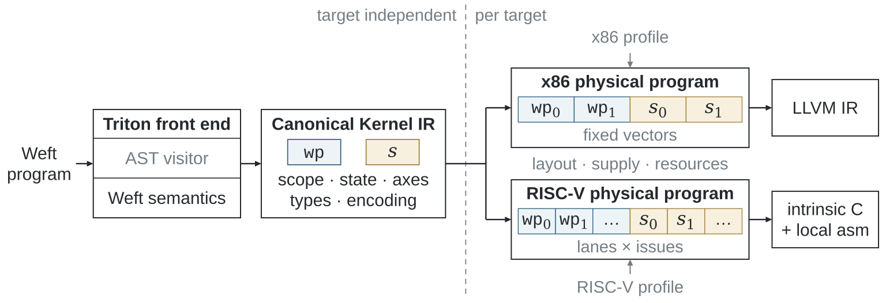

# Triton–Weft 1.0 工具书

Weft 让 CPU 内核作者在同一程序中组合数据表示、局部算术、共享准备和状态演进。
Triton 前端把这些选择保留到共同的 Canonical IR，再为 x86 与 RISC-V
构造原生向量和矩阵执行。

## 从完整程序开始

[安装 Weft](getting-started/installation.md)，运行[快速上手](getting-started/quickstart.md)：
程序通过带类型的 View、共享输入和跨块更新的状态计算每行平方和。
随后运行[完整示例](getting-started/examples.md)中的 Q4_K 投影、在线注意力、
Welford 统计和 GEMM。

| 接下来要做的事 | 阅读入口 |
|---|---|
| 表达存储与数值选择 | [编程模型](programming-model/index.md)、[Encoding](dsl/encoding-and-artifacts.md)、[运算](dsl/functions-and-operations.md) |
| 组合共享与状态 | [Level 与状态](dsl/values-and-levels.md)、[模型程序](dsl/programs.md) |
| 选择核心与计算引擎 | [目标与 engine](getting-started/hardware.md) |
| 调优与部署 | [JIT 与自动调优](compiler/runtime.md)、[原生 C/C++](compiler/native-sdk.md)、[llama.cpp](integrations/llama-cpp.md) |
| 复现实验 | [Bench 工作流](experiments/reproduce.md)、[结果与数据](experiments/results.md) |
| 开发编译器 | [编译管线](compiler/index.md)、[passes](compiler/passes.md)、[源码地图](development/upstream.md) |

页面语言选择器切换到对应的英文或中文章节，两种版本统一使用
`import triton.language as tl`。

## 从源程序关系到原生执行

作者使用 `@triton.jit(model="weft")`，通过 `kernel[grid](...)` 调用。
字段、数值分组、共享和状态在编译过程中保持显式；
目标 pass 决定向量布局、矩阵片段与局部存储。
运行时支持 JIT 缓存、自动调优、原生导出和应用调用。

## 实测结果

最终论文数据集包含 **553 个算子—平台案例**，其中 **543 项**
与优化的 GGML、oneDNN 参考实现进行匹配比较。

| 平台 | 匹配比较 | 几何平均加速 |
|---|---:|---:|
| SG2044 | 132 | **1.60×** |
| K1 | 136 | **1.54×** |
| K3 A100 | 135 | **1.83×** |
| Xeon Platinum 8470Q | 140 | **1.32×** |

完整推理覆盖八组模型—平台部署、18 项阶段比较。
SG2044 使用 64 个应用线程；K1、K3 和 x86 使用八线程。
K3 同时展示 CPU 向量参考与厂商 IME2 部署比较。

[结果与来源](experiments/results.md)提供十四份最终 CSV 和当前矢量图。
[Triton–Weft Bench](https://github.com/Tianchen-ai/triton-weft-bench)
负责比较用例、参考分派、数值检查和计时；产品负责编译器、运行时和可安装内核库。

## 版本与实现

Weft **1.0.0** 扩展自 Triton **3.8.0**，发行包版本为
`3.8.0+weft.1.0.0`，Python API 分别提供两个版本标识。
[发布指南](development/release.md)介绍源码包与验证；
[设计规格](https://github.com/Tianchen-ai/triton-weft/tree/main/docs/specification)
给出完整语言与编译器合同。
