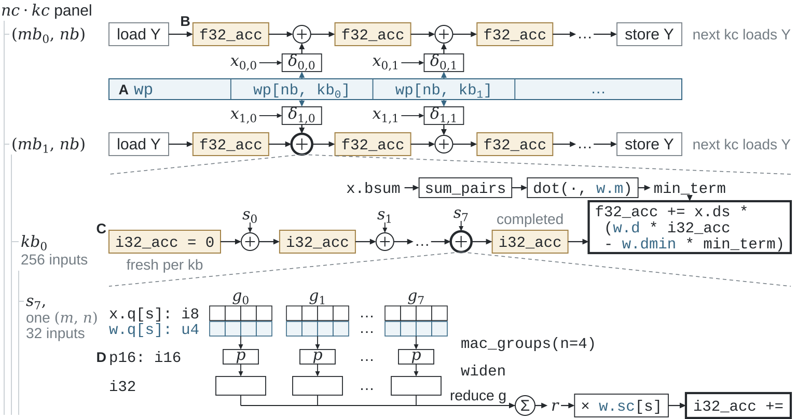

# Program the relationships that control work

A CPU kernel often has several useful boundaries: a stored record, a group of
integer products, an output tile, a reusable panel, and an accumulator that lives
across panels. Weft lets the author express each boundary and its relationship to
the others. The compiler uses that information to implement the program on a
specific vector or matrix machine.

## Four connected choices

| Choice | Source construct | Example |
|---|---|---|
| How bytes represent logical data | Encoding and View | A Q4 record holds packed values and separate scale fields |
| Which operations form a numerical contribution | Typed arithmetic, grouped MAC, widen/reduce | Four products accumulate in I16 before widening to I32 |
| Which consumers share a value | Level and stage | Several output groups consume one staged weight panel |
| How long an update chain lives | Level and state | An F32 accumulator persists across all blocks of a panel |

[](../assets/paper/model.svg)

In the paper's Q4_K projection, **A** is a shared weight panel; **B** is each
output group's F32 state; **C** is an I32 state for one 256-element block; **D**
contains the grouped I16 partials. Changing the shared panel's scope affects
repeated preparation. Changing a partial's width affects arithmetic and conversion.
Both choices remain visible in the source.

## A small complete example

The [Level tutorial](https://github.com/Tianchen-ai/triton-weft/blob/main/examples/weft/language/levels.py)
computes row sums of squares:

```python
from __future__ import annotations
import triton
import triton.language as tl

@triton.jit(model="weft")
def row_sum_squares(X: tl.View[tl.f32, (M, N)],
                    Y: tl.View[tl.f32, (M,)], B: tl.constexpr = 32):
    with tl.level.rows(M, group=1) as row:
        values = tl.stage(tl.load(X[row]))
        total = tl.state(tl.f32, [1], init=0)
        with tl.level.blocks(N, extent=B) as block:
            part = values[:, block]
            total += tl.reduce(part * part, axis="n", op="add")
        tl.store(Y[row], total)
```

The row owns `values` and `total`. Each inner block contributes to the same
state, including the partial final block. The compiler can partition that logical
row across machine registers and issue steps while retaining its initialization
and update boundaries.

## How the compiler uses the model

| Source information | Physical decision it enables |
|---|---|
| Field bit mapping and declared signedness | Decode, gather, unpack and legal machine widths |
| Logical free and reduction axes | Lane placement, packet shape and reduction structure |
| Shared Value and its consumers | Register residence, local packing or legal reload |
| State lifetime and handoff | Accumulator representation, carry storage and scheduling |
| `engine` and target capability | RVV/IME or SIMD/AMX operations for each contraction |

The author controls logical blocking, numerical branches, persistent layouts and
scope. The compiler controls the physical implementation within those choices.
This is also the optimization workflow: adjust the DSL when the algorithm should
perform different work; improve a pass when the existing relationships admit a
better physical realization.

## Compose with Triton

Ordinary pointers, tensor broadcasting, `tl.sum`, `tl.dot`, helpers and control
flow use Triton's shared frontend. View and named-axis values add explicit shape
identity; Encoding adds a storage map; Level adds ownership and carry.
Grid remains the application's partition into independent program instances.

Read [Encoding](../dsl/encoding-and-artifacts.md), [Level and state](../dsl/values-and-levels.md)
and [numerical operations](../dsl/functions-and-operations.md) in that order.
The complete [model contract](https://github.com/Tianchen-ai/triton-weft/blob/main/docs/specification/programming-model/index.md)
defines the author/physical boundary.
